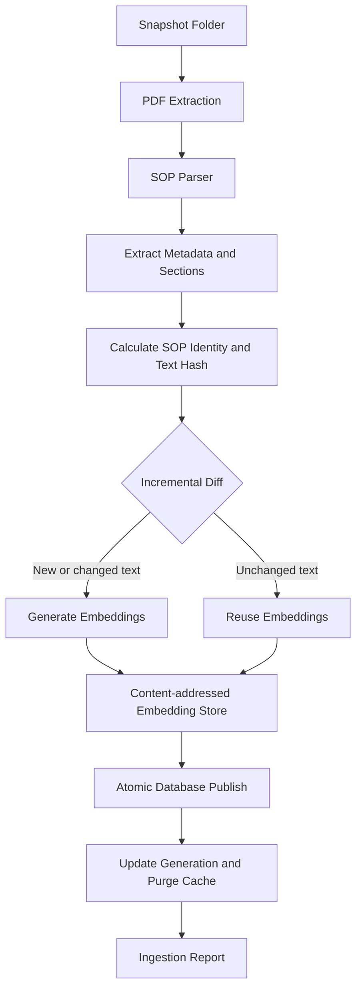
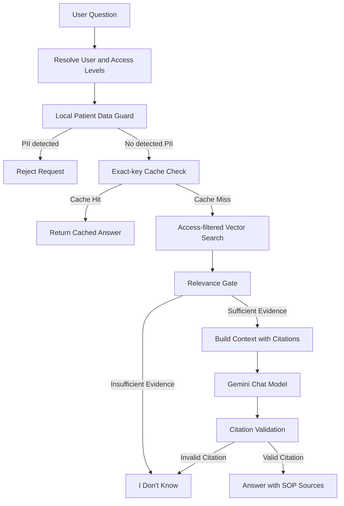

# MediCare SOP Assistant (RAG PoC)

An internal AI-powered assistant that helps staff across 25 MediCare clinics find accurate answers from current Standard Operating Procedures (SOPs).

The assistant answers questions using authorized SOP documents, provides source citations, respects role-based document access, and refuses questions containing detected patient-identifiable information.

**Key principles:**
- Answers are grounded in the current SOP library.
- Every answer includes SOP ID, version, section and page citations.
- Restricted documents are filtered before retrieval scoring.
- Questions not sufficiently supported by accessible SOPs receive an "I don't know" response.
- Patient data detected by the local PII guard is rejected before reaching the LLM.
- Document updates are incremental and published atomically.

> **Confidentiality:** The supplied assignment data pack is fictional and confidential. Keep this repository private. Do not upload the assignment documents or API credentials to public repositories.

---

## 1. Project Overview

MediCare operates 25 clinics where staff need quick access to operational procedures, including vaccination storage, infection control, equipment handling and other clinic processes.

Traditional shared-drive searches can return outdated or restricted documents, making it difficult to identify the correct procedure.

This proof of concept implements a Retrieval-Augmented Generation (RAG) assistant that:

1. Ingests and parses SOP PDF documents.
2. Extracts SOP identity, version, access level and section information.
3. Creates searchable embeddings.
4. Retrieves only documents the requesting user is authorized to access.
5. Generates answers grounded in retrieved SOP content.
6. Validates citations before returning an answer.
7. Rejects questions containing detected patient-identifiable information.

## 2. Technology Stack

| Component | Technology |
|---|---|
| Language | Python |
| API framework | FastAPI |
| LLM provider | Google Gemini |
| Chat model | Gemini 3.5 Flash Lite |
| Embedding model | gemini-embedding-001 |
| Embedding dimensions | 768 |
| Vector similarity | NumPy |
| Database | SQLite (WAL mode) |
| PDF extraction | pdfplumber |
| HTTP client | httpx |
| Configuration | Environment variables |
| Testing | Pytest |
| Containerization | Docker Compose |

The application uses provider interfaces to separate the core application logic from the LLM and embedding implementations.

Both Gemini and a deterministic fake provider are supported.

## 3. Architecture

The application follows a layered architecture with separate domain rules, interfaces, use cases, infrastructure adapters and API delivery.

### Ingestion workflow



### Question-answering workflow



### Main architectural components

| Layer | Location | Responsibility |
|---|---|---|
| Domain | `app/domain/` | Access rules, PII detection, models and errors |
| Ports | `app/ports.py` | Chat model and embedding interfaces |
| Answer service | `app/service/answer_service.py` | Question processing and answer generation |
| Ingestion | `app/ingest/` | PDF parsing, SOP processing and incremental indexing |
| Providers | `app/providers/` | Gemini and deterministic fake adapters |
| Storage | `app/store/` | SQLite persistence and vector indexing |
| API | `app/api/main.py` | FastAPI endpoints |
| CLI | `app/cli.py` | Command-line operations |
| Composition root | `app/container.py` | Provider and dependency configuration |

Architecture decisions, design trade-offs and four Architecture Decision Records (ADRs) are documented in:

- `docs/ai_design_proposal.md`
- `docs/design_review.md`

## 4. Key Features

### RAG-based question answering
- Retrieves relevant SOP sections using embeddings.
- Uses the LLM to generate grounded answers.
- Provides SOP ID, version, section and page citations.
- Returns an insufficient-evidence response when appropriate.

### Role-Based Access Control (RBAC)
- Maps users to authorized access levels.
- Filters restricted documents before similarity scoring.
- Rechecks access when retrieving related sections.
- Prevents unauthorized SOP content from entering the LLM context.

### Patient Data Protection
- Uses deterministic local PII detection.
- Rejects detected patient-identifiable information.
- Does not intentionally send rejected questions to the LLM.
- Supports detection of the configured PII categories and common Indian formats.

### Incremental Indexing
- Detects new, changed, unchanged, renamed and withdrawn SOPs.
- Uses stable SOP identity and normalized-text hashes.
- Reuses existing embeddings for unchanged text.
- Avoids unnecessary embedding API calls.
- Publishes library changes through a single SQLite transaction.

### Answer Caching
- Uses an exact-key cache.
- Includes normalized question, access levels, index generation and model/prompt configuration in cache identity.
- Prevents stale answers from being reused after library updates.
- Prevents cross-access-level cache reuse.

### Citation Validation
- Validates generated citation labels against retrieved chunk metadata.
- Rejects unsupported or invalid citations.
- Returns an insufficient-evidence response when valid citations cannot be established.

## 5. Evaluation Results

The application was evaluated using both the deterministic offline fake provider and the actual Google Gemini API.

### Actual Gemini evaluation

<badge color="success">All evaluation checks passed</badge>

| Evaluation category | Result |
|---|---:|
| Original questions | 15/15 |
| Answerable questions | 10/10 |
| Unanswerable questions | 3/3 |
| Conflict questions | 2/2 |
| Updated questions | 8/8 |
| PII protection | 5/5 |
| Retrieval checks | 18/18 |
| Governance violations | 0 |

### Actual Gemini API metrics

| Metric | Result |
|---|---:|
| LLM calls | 23 |
| Total tokens | 42,512 |
| Total API cost | $0.018067 |
| Mean latency | 5.73 seconds |
| Total evaluation time | 387.2 seconds |

These measurements represent the assignment evaluation run, not guaranteed production performance or future API pricing.

### Offline test results

```text
110 passed in 4.48s
```

Zero test failures.

The automated tests cover:

- Answer service
- Answer caching
- RBAC
- PII detection
- API validation
- Gemini adapters
- HTTP retries
- Incremental indexing
- Crash safety
- Concurrent publishing
- PDF parsing
- SOP metadata validation

### Incremental indexing results

| Operation | Result |
|---|---:|
| Added | 2 |
| Updated | 3 |
| Withdrawn | 1 |
| Renamed | 1 |
| Unchanged | 10 |
| Texts embedded | 13 |
| Embeddings reused | 16 |
| Embedding API calls | 1 |

A second indexing run returned `no_changes` and required zero embedding calls.

### Evaluation documentation

Detailed results are available in:

- `docs/eval_results_gemini.md` — actual Gemini evaluation.
- `docs/eval_results.md` — evaluation documentation.
- `docs/eval_results_fake.md` — deterministic fake-provider evaluation.
- `docs/test_report.md` — automated test report.

The fake provider is a deterministic testing adapter, not a substitute for the actual Gemini evaluation.

## 6. API Reference

FastAPI exposes an OpenAPI specification and interactive Swagger documentation.

| Method | Endpoint | Purpose |
|---|---|---|
| POST | `/v1/ask` | Ask a question and receive a grounded answer |
| GET | `/v1/documents?user_id=` | List SOPs accessible to a user |
| POST | `/v1/admin/reindex` | Trigger document indexing |
| GET | `/healthz` | Check application and index status |

### Example request

```bash
curl -X POST http://localhost:8000/v1/ask \
  -H "Content-Type: application/json" \
  -d '{
    "user_id": "U2001",
    "question": "What should I do if the vaccine fridge shows 10 degrees?"
  }'
```

### Example response structure

```json
{
  "status": "answered",
  "answer": "Answer grounded in the applicable SOP.",
  "citations": [
    {
      "sop_id": "SOP-001",
      "version": "1.0",
      "title": "Example SOP",
      "section": "3",
      "section_title": "Example section",
      "page": 2
    }
  ],
  "conflict": false,
  "cached": false,
  "index_generation": 1,
  "correlation_id": "example-id"
}
```

The example illustrates the response structure; actual answer content and citation metadata depend on the indexed SOP library.

### Error handling

| HTTP status | Error | Description |
|---|---|---|
| 400 | `validation_error` | Invalid request body |
| 400 | `invalid_question` | Empty or excessively long question |
| 400 | `ingestion_error` | Rejected or invalid snapshot |
| 403 | `unknown_user` | User not found in configured directory |
| 422 | `patient_data_detected` | Detected patient-identifiable information |
| 503 | `upstream_unavailable` | LLM service unavailable after retries |
| 503 | `index_not_ready` | Index unavailable or empty |
| 500 | `internal_error` | Unexpected application error |

Every response includes an `x-correlation-id`.

## 7. Installation and Setup

### Prerequisites

- Python 3.10 or compatible supported Python version.
- Git.
- Make, or an equivalent way to execute the project's Makefile commands.
- Google Gemini API key for actual Gemini evaluation and inference.
- Docker Desktop only if using the containerized setup.

### Clone the repository

```bash
git clone <YOUR_PRIVATE_REPOSITORY_URL>
cd sop-assistant
```

### Create a virtual environment

Linux/macOS:

```bash
python3 -m venv .venv
source .venv/bin/activate
```

Windows PowerShell:

```powershell
python -m venv .venv
.venv\Scripts\Activate.ps1
```

### Install dependencies

```bash
make install
```

### Configure environment variables

Copy the example configuration:

Linux/macOS:

```bash
cp .env.example .env
```

Windows PowerShell:

```powershell
Copy-Item .env.example .env
```

For the actual Gemini provider, configure the local `.env` file:

```env
LLM_PROVIDER=gemini
GEMINI_API_KEY=your_local_api_key
GEMINI_CHAT_MODEL=gemini-3.5-flash-lite
GEMINI_EMBED_MODEL=gemini-embedding-001
```

The example above is for configuration guidance only. Never commit `.env` or expose API credentials.

The deterministic fake provider can be used for offline testing without making real Gemini API calls.

Refer to `.env.example` for the complete configuration options.

### Run offline tests

```bash
make test
```

Expected result:

```text
110 passed
```

### Start the application

```bash
make run
```

The API is served on:

```text
http://localhost:8000
```

Swagger UI:

```text
http://localhost:8000/docs
```

OpenAPI specification:

```text
http://localhost:8000/openapi.json
```

### Docker setup

```bash
docker compose up
```

The Docker Compose configuration uses a named volume for persistent index storage.

Note: Docker Compose configuration is provided, but the containerized deployment was not verified in the assignment build environment.

## 8. Indexing and Evaluation Commands

The project includes Makefile commands for common operations.

| Command | Purpose |
|---|---|
| `make install` | Install project dependencies |
| `make test` | Run offline automated tests |
| `make run` | Start the FastAPI application |
| `make update` | Apply the configured SOP snapshot incrementally |
| `make eval` | Run deterministic fake-provider evaluation |
| `make eval-gemini` | Run actual Gemini evaluation |

The Gemini evaluation makes real API calls and incurs usage costs. It should not be run unnecessarily.

The indexing process generates a report showing added, updated, withdrawn, renamed and unchanged documents.

## 9. Configuration and Security

Application settings are managed through environment variables and configuration files.

Important security considerations:

- API credentials must remain in local environment configuration.
- `.env` must not be committed.
- User authorization is currently based on the configured user directory and request-supplied user ID.
- Production deployment requires authenticated identity from an SSO provider.
- The PII guard operates locally before LLM invocation.
- Access filtering occurs before retrieval scoring.
- The administration endpoint requires external authentication and network-level protection in production.

The implementation provides application-level access enforcement but is not a replacement for production identity management or a complete security audit.

## 10. Known Limitations and Production Considerations

This is a working proof of concept, not a production-certified clinical system.

| Area | Current limitation / next step |
|---|---|
| Authentication | User identity is supplied in the request body. Integrate Google Workspace or Microsoft Entra ID SSO. |
| Admin security | The reindex endpoint has no independent authentication. Protect it through production IAM and network controls. |
| PII detection | Rule-based detection cannot identify every possible patient reference, including bare first names without contextual cues. |
| Conflict detection | Conflicts are identified at question time over retrieved SOPs. Ingestion-time conflict detection remains future work. |
| PDF support | Image-only scanned PDFs are not supported. OCR integration is required. |
| Deployment | SQLite and an in-memory index suit the current single-node PoC. Multi-instance deployment requires a distributed architecture and appropriate shared storage. |
| Search | Hybrid search and reranking were not implemented. They should be evaluated against a larger and more challenging SOP library. |
| Cache concurrency | Identical concurrent cache misses can trigger multiple LLM calls. Single-flight request handling is a future improvement. |
| User interface | No dedicated staff-facing frontend was built. Swagger UI is used for the PoC demonstration. |
| Clinical validation | Answers require review and validation by authorized clinical and operational stakeholders before real-world use. |

### Production roadmap

1. Integrate enterprise SSO and authenticated user identity.
2. Add OCR for scanned SOP documents.
3. Introduce a dedicated administration interface and stronger audit controls.
4. Evaluate hybrid retrieval and reranking on a larger SOP collection.
5. Implement distributed storage for multi-instance deployment.
6. Add operational monitoring, alerting and service-level measurements.
7. Complete clinical validation, privacy review and security assessment.
8. Conduct a controlled pilot before wider clinic deployment.

## 11. Project Structure

```text
sop-assistant/
│
├── app/
│   ├── domain/
│   ├── service/
│   ├── providers/
│   ├── ingest/
│   ├── store/
│   ├── api/
│   ├── ports.py
│   ├── cli.py
│   └── container.py
│
├── eval/
│   ├── run_eval.py
│   ├── criteria.py
│   └── results_*.json
│
├── tests/
│
├── docs/
│   ├── ai_design_proposal.md
│   ├── clarifying_questions.md
│   ├── design_review.md
│   ├── eval_results.md
│   ├── eval_results_fake.md
│   ├── eval_results_gemini.md
│   ├── pitch_script.md
│   ├── solution_brief.md
│   └── test_report.md
│
├── data/
│   └── sops/
│
├── AI_USAGE.md
├── README.md
├── .env.example
├── .gitignore
├── Makefile
└── docker-compose.yml
```

Actual files and directories may vary slightly with the final repository configuration.

## 12. Architecture Decision Records

Four ADRs document the main engineering decisions:

1. **ADR-1: Document identity and change detection** — stable SOP identity and normalized-text hashing.
2. **ADR-2: Answer-cache key and invalidation** — exact-key caching with access levels and index generation.
3. **ADR-3: SQLite storage and atomic publishing** — transactional library updates.
4. **ADR-4: Local PII detection and rejection** — deterministic detection before external LLM processing.

These decisions and the differences between the original proposal and final implementation are explained in `docs/design_review.md`.

## 13. AI Tool Usage

AI-assisted development was used during implementation and documentation.

The project documents:
- AI tools used.
- Important prompts.
- AI-generated mistakes and how they were identified.
- Human verification and engineering decisions.
- Limitations of automated verification.

Refer to [`AI_USAGE.md`](AI_USAGE.md) for the complete disclosure.

---

**Project:** MediCare Clinics – SOP Assistant

**Organization:** D3V Technology Solutions

**Role:** AI/ML Engineer

**Submission date:** 20 November 2026

**Status:** Working proof of concept; production hardening and clinical validation pending.